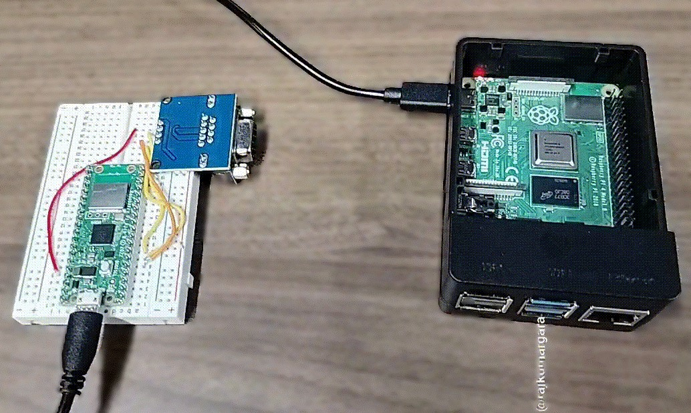
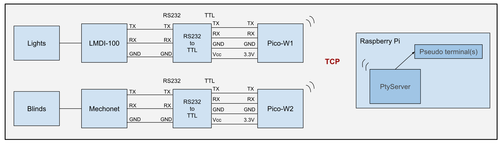
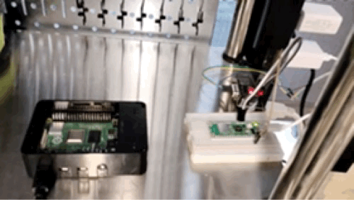

# About
Ever need a serial port far away from your Raspberry Pi? Wish you could use WiFi to talk to a serial device without having to run a wire? This project is for you.

## How it works

A Pico W is wired to your serial device and joins your WiFi. It opens a TCP
connection back to the Raspberry Pi and announces itself. The Pi allocates a
pseudo-terminal (pty) for that Pico and symlinks it into
`/opt/remote-serial-pico/ports/`. Any program on the Pi can then open that
symlink as an ordinary serial port — every byte written to it comes out of the
Pico's UART, and every byte the Pico's UART receives shows up on the pty.

```
[serial device] --UART 19200--> [Pico W] --WiFi/TCP:50000--> [Pi: PtyServer] --> /opt/remote-serial-pico/ports/<name> -> /dev/pts/N
```

## Requirements

**Raspberry Pi (the server)**
* Raspberry Pi OS (Bookworm or later) with NetworkManager — the default on Bookworm.
* Node.js 18+ (developed on v20). `node-pty` is compiled at install time, so
  you also need `build-essential` and `python3`.
* On the same network as the Picos: either joined to the WiFi through
  NetworkManager (WPA-PSK), or hosting the Picos' access point itself with
  hostapd. The deployer reads the WiFi name and password from whichever it finds.
* A stable IP address on that network. A Pico is given the Pi's address when it
  is provisioned and does not rediscover it, so use a DHCP reservation or a
  static address — otherwise every Pico stops connecting the day the address
  changes, until it is plugged into the Pi again.
* Internet access during `install` only (apt, npm, and the MicroPython images).
  Nothing is downloaded afterwards.

**Pico**
* A **Pico W** or Pico 2 W. Plain Picos have no WiFi and will not work.

**Both**
* The Pi and the Picos must be on the same WiFi network, and that network must
  allow client-to-client traffic (many guest/isolated SSIDs do not).

## Part 1 — Set up the Raspberry Pi

<a href="https://www.youtube.com/shorts/CbkAj24SPnE" target="_blank">
    
</a>

```bash
sudo apt update
sudo apt install -y nodejs npm build-essential python3 python3-venv python3-pip
sudo npm i -g remote-serial-pico
sudo remote-serial-pico install
```

That is the whole setup: no file to edit and nothing to copy by hand. `install`
runs these steps in order and skips anything already done, so running it again
is safe. Re-running it after `sudo npm i -g remote-serial-pico` upgrades the
installed app in place.

| Step | What it does |
| --- | --- |
| apt packages | python3, venv, pip, build-essential, udisks2 |
| service user | creates the system account `rspico` for the server, and adds you to its group so you can open the ports |
| directories | the install root and everything under it (below) |
| application | copies this package into `<root>/app`, owned by root, and checks `node-pty` loads under the `node` the service will use |
| rshell venv | `<root>/venv` with `rshell`, owned by root |
| `config.yaml` | generated from [config.example.yaml](./src/pi/config.example.yaml) with the install root and the network interface the Picos use filled in; never overwritten |
| serial map, key store | created empty if missing (key store mode `0600`); never overwritten |
| udev rules | rendered from `src/pi/*.rules.in`, reloaded only when one changed |
| firewall | off unless you ask for it with `--firewall` |
| service | unit written and `enable`d so it survives reboots, (re)started |
| service running | waits until the service is really active and listening, and fails if it is not |
| firmware cache | downloads the MicroPython images pinned in [firmware-manifest.json](./src/pi/firmware-manifest.json) and checks their sha256 |

Then check it:

```bash
remote-serial-pico doctor    # every component, with a fix hint for anything wrong
remote-serial-pico status    # is it up, which Picos are connected, on what firmware
```

`doctor` exits non-zero if anything is wrong, so it can gate a script. Log out
and back in once after the first install so your new group membership applies.

### Controlling a board without walking to it

```bash
remote-serial-pico ctl Blinds_pico status              # firmware, uptime, WiFi signal, serial counters
remote-serial-pico ctl Blinds_pico identify 30         # blink its LED for 30 s so you can find it
remote-serial-pico ctl Blinds_pico reboot
remote-serial-pico ctl Blinds_pico uart set 9600       # retune the serial link: baud [bits parity stop]
remote-serial-pico ctl Blinds_pico uart set 9600 8 N 1 --save
remote-serial-pico ctl Blinds_pico listen              # watch the serial traffic in hex, Ctrl-C to stop
remote-serial-pico ctl Blinds_pico update              # bring its firmware up to date (see below)
```

The name is the port name shown by `remote-serial-pico status`. These commands
travel on their own channel: nothing they send or receive ever shows up in the
serial port, and a board only obeys them from the Pi it was provisioned on.

`uart set` lasts **until the board restarts** unless you add `--save`. That is
deliberate: if you set a baud rate that does not match the device, power-cycle
the board and it is back to what it had. With `--save` the setting is kept
across restarts, so check it works first.

Anyone who may open the ports (members of the `rspico` group) may use `ctl`.
Every command and its result is written to the server log.

### Updating board firmware over the air

When the firmware in this package changes, boards still run the old one. By
default such a board is refused until you plug it into the Pi again. Instead,
the Pi can send it the new firmware over WiFi:

```bash
remote-serial-pico ctl Blinds_pico update     # this one board, now
```

Do that for **one board first** and check it comes back in
`remote-serial-pico status` on the new firmware. To let every board update
itself the next time it connects, one at a time, set `FirmwareUpdate: true`
in `config.yaml` and restart the service.

What makes this safe to use:

* A board is only updated when it connects, before it relays anything, never
  in the middle of an operation.
* It only accepts firmware from the Pi it was provisioned on.
* It checks every file it received before replacing anything. A cut-off or
  corrupted update is thrown away and the board carries on as it was.
* It keeps its previous firmware. If the new one does not start and register
  with the Pi within three attempts, the board goes back to the previous one
  by itself.

The server log shows each update with the old and the new firmware hash.
A board that was never plugged into this Pi cannot be updated this way; it
has no key yet.

### Where everything lives

Everything is under one install root, `/opt/remote-serial-pico` by default.
`--root <dir>` on the first install puts it elsewhere; later runs remember it.

```
/opt/remote-serial-pico/        root-owned
  app/                          the installed copy of this package
  venv/                         Python venv with rshell
  firmware/                     MicroPython .uf2 cache, and the autoflash-enabled kill switch
  log/deployer.log              what the provisioning scripts did
  config.yaml                   the one config file
  data/                         owned by the service user
    pico_serial_map.yaml        serial id -> port name          (back this up)
    pico_secrets.yaml           per-device keys, mode 0600      (back this up)
    state.json                  what `status` reads
    control.sock                where `ctl` reaches the server
    ptyserver.log               every command and response
  ports/                        owned by the service user: <name> -> /dev/pts/N
```

udev runs the provisioning scripts as root when a Pico is plugged in, so
everything root executes or reads (`app/`, `venv/`, `firmware/`, `config.yaml`)
is owned by root. The server runs as its own unprivileged user, `rspico`, which
can write only `data/` and `ports/`.

Upgrading from an install that lived in `/home/project`: run `install`, then
bring your port names across and restart the service. Ports move to
`/opt/remote-serial-pico/ports/`, and boards need plugging into the Pi once more.

```bash
sudo install -o rspico -g rspico -m 644 /home/project/pico_serial_map.yaml /opt/remote-serial-pico/data/
sudo systemctl restart ptyserver.service
```

### config.yaml

`/opt/remote-serial-pico/config.yaml` is read by the server, by the provisioning
scripts and by the CLI, so a value is never written down twice. Restart the
service after editing it: `sudo systemctl restart ptyserver.service`.

| Key | Meaning |
| --- | --- |
| `PicoSerialMap` | Where the serial-ID → friendly-name map is stored |
| `PicoSecrets` | Per-device key store, mode `0600`. Written by the deployer each time a board is plugged in |
| `StateFile` | Last known firmware and connection state of each board, for `status` |
| `ControlSocket` | Where `remote-serial-pico ctl` reaches the server |
| `symlinkDir` | Where the port symlinks are created |
| `FirmwareDir` | MicroPython image cache and the auto-flash kill switch |
| `DeployerLog` | Log of the provisioning scripts |
| `SyslogDir` | Unix syslog socket, normally `/dev/log` |
| `CustomlogDir` | Plain-text application log |
| `TCP_PORT` | Port the Picos connect to. The deployer writes it into each board's `config.json`, so change it here and re-plug the boards |
| `BindAddress` | Where the server listens, and the address each Pico is told to connect to. An interface name (`wlan0`) is resolved each time the service starts; an IPv4 address pins it. `0.0.0.0` listens everywhere, which `doctor` reports as a problem |
| `FirmwareUpdate` | `false` (default): no board is updated unless you run `ctl <name> update` for it. `true`: any board on other firmware is updated when it connects, one at a time |
| `FirmwareMismatch` | What to do with a board whose firmware is not what this Pi would deploy: `refuse` (default) turns it away until it is plugged into the Pi again, `warn` serves it and logs. See [docs/protocol.md](./docs/protocol.md) |

### Install options

| Option | What it does |
| --- | --- |
| `--root <dir>` | Install root instead of `/opt/remote-serial-pico` |
| `--user <name>` | Run the server as an existing user instead of creating `rspico` |
| `--firewall` | Also drop connections to the Pico port that come from outside the Pico subnet (uses nftables). `--no-firewall` removes the rule |
| `--firmware-from <dir>` | Take the MicroPython `.uf2` files from a directory instead of downloading them, for a Pi with no internet |

## Part 2 — Load the software onto the Pico

### Step 1: Get MicroPython onto the board

A Pico ships with its flash erased — no MicroPython, no firmware of any kind. Only
the UF2 bootloader in unerasable ROM is present, which is why a Pico is very hard
to brick. The Pi can flash MicroPython for you. It is off until you turn it on,
so the Pi can still be used to flash unrelated boards:

```bash
sudo touch /opt/remote-serial-pico/firmware/autoflash-enabled
```

Then plug in a board in BOOTSEL mode. A factory-fresh board is already in it;
for one that has been flashed before, hold **BOOTSEL** while plugging it in and
let go once it is in. Within about fifteen seconds it reboots as MicroPython and
step 2 happens by itself. Watch it with
`tail -f /opt/remote-serial-pico/log/deployer.log` or
`journalctl -f -u 'pico-flash-*'`. Remove `autoflash-enabled` to switch it off
again.

The images were cached by `install`; nothing is downloaded when a board is
plugged in. The flasher only touches a volume labelled `RPI-RP2` or `RP2350`,
and it treats the board vanishing mid-copy as success, because that is the
board rebooting.

To do it by hand instead: download the UF2 for your board from
<https://micropython.org/download/> (`RPI_PICO_W` or `RPI_PICO2_W`), plug the
board in BOOTSEL mode into any computer, and copy the file onto the `RPI-RP2`
drive that appears.

> Buy the **Pico W** or **Pico 2 W** — a non-wireless Pico has no WiFi and cannot
> work. Headers are only pre-soldered on the "H" variants; this project needs GP4,
> GP5 and GND, so a plain board means soldering.

### Step 2: Plug it into the Pi

With MicroPython on board, just plug the Pico into the Pi's USB port. The udev
rule fires [PicoScriptDeployer.py](./src/pi/PicoScriptDeployer.py), which:

1. Reads the Pi's WiFi name and password (from NetworkManager via `nmcli`, or
   from `/etc/hostapd/hostapd.conf` if the Pi hosts the Picos' access point
   itself).
2. Generates a new random 256-bit **device key** for this board.
3. Builds a `config.json` for this one board from those, the address and port
   the server listens on (`BindAddress` and `TCP_PORT` in `config.yaml`), and
   the board's USB serial number.
4. Uses `rshell` to copy `config.json` and the firmware (every file named in
   [firmware.json](./src/pico/firmware.json)) onto the board.
5. Records the key in the key store, so the server will recognise the board.

**A board only works with the Pi it was plugged into.** When it connects over
WiFi it has to prove it holds its key, and the Pi has to prove the same back,
before any serial data moves; after that every message carries a tamper
check. Knowing a board's serial number is not enough to impersonate it. A
board that was never plugged into this Pi, that runs older firmware, or whose
firmware differs from what this Pi deploys is refused until you plug it in
again. Plugging a board in again also gives it a fresh key.

The `config.json` holds your WiFi password and the device key. It is built in a private temporary
directory and removed once it is on the board; it is never written into the
installed app or this repository. [config.example.json](./src/pico/config.example.json)
shows its shape.

It takes a few seconds. Watch it happen:

```bash
tail -f /opt/remote-serial-pico/log/deployer.log
```

Then unplug the Pico, power it from any USB supply within WiFi range, and wire it
to your serial device: **GP4 = TX, GP5 = RX, plus a common ground**, 19200 8N1.

### Doing it manually

If you want to load a Pico from a different machine:

```bash
cp src/pico/config.example.json /tmp/config.json
# edit /tmp/config.json — SSID, password, the Pi's address, PORT to match TCP_PORT,
# and add "KEY": "<64 hex characters>", e.g. from: openssl rand -hex 32
rshell -p /dev/ttyACM0 cp src/pico/firmware.json src/pico/main.py src/pico/net_util.py src/pico/frame.py src/pico/auth.py /tmp/config.json /pyboard/
rm /tmp/config.json
```

Then put the same key on record on the Pi, or the server will refuse the
board, as one line `<serial id>: '<key>'` in
`/opt/remote-serial-pico/data/pico_secrets.yaml` (edit it with `sudo -u rspico`).

`PICO_ID` in that file is only a label; the Pi keys off it to name the port, so
give each board a distinct value if you set it by hand.

## Naming your serial ports

The first time a Pico connects, the Pi records it in
`/opt/remote-serial-pico/data/pico_serial_map.yaml` using its serial ID for both
key and name, and creates a symlink named after it:

```yaml
e66164084319422c: e66164084319422c
```

Edit the value to whatever you want the port to be called (the file belongs to
the service user, so use `sudo`), then restart the service:

```yaml
e66164084319422c: Lights_pico
e6614103e71d2c2f: Blinds_pico
```

```bash
sudo systemctl restart ptyserver.service
```

You now have `/opt/remote-serial-pico/ports/Lights_pico` and
`/opt/remote-serial-pico/ports/Blinds_pico`. Point any serial-aware program at
those paths:

```bash
remote-serial-pico status                                # what is connected, on what firmware
screen /opt/remote-serial-pico/ports/Blinds_pico 19200
```

A port can be opened by the service user and by members of its group, `rspico`.
The installer adds whoever ran it; for a program that runs as someone else
(a Node-RED service user, say): `sudo usermod -aG rspico <that user>`, then
restart that program.

The symlink target changes every time the service restarts, because a new pty is
allocated — always open the symlink, never `/dev/pts/N` directly. Programs that
hold the old pty open (Node-RED, for instance) need to be restarted after the
PtyServer service restarts.

## Troubleshooting

Start with `remote-serial-pico doctor`: it checks each of these and prints the fix.

| Symptom | Cause / fix |
| --- | --- |
| Service dies instantly | `config.yaml` missing or unreadable. `journalctl -u ptyserver.service -n 20` |
| Service is up but `status` says NOT listening | `BindAddress` names an interface with no IPv4 address yet; the server waits for it. Bring the interface up or change `BindAddress` |
| `Permission denied` opening a port | You are not in the `rspico` group yet: log out and back in after the first install |
| Nothing in `deployer.log` on plug-in | A board in BOOTSEL/mass-storage mode is not `2e8a:0005`; turn on auto-flash (Part 2, step 1) or flash MicroPython by hand |
| Log says `refusing <id>: no device key on record` | The board was never plugged into this Pi (or its key was lost). Plug it in |
| Log says `refusing <id>: it does not hold the device key` | The board's key and the Pi's differ, or something is impersonating the board. Plug the real board in to re-key it |
| Log says `refusing <id>: it runs firmware ...` | The board's firmware is not what this Pi deploys. Run `remote-serial-pico ctl <name> update`, or plug it in, or set `FirmwareMismatch: warn` |
| Log says `firmware update: <id> did NOT take the update` | The reason follows in the same line. The board is still on its old firmware and still works with `FirmwareMismatch: warn`; plug it in to update it over USB |
| Deployer runs but Pico never connects | Wrong SSID/password captured, the Pi's address changed since the board was provisioned, or client isolation on the WiFi. Plug the board into the Pi again to re-provision it |
| Pico LED blinks forever | Cannot join WiFi — plug it into the Pi again |
| `cannot open .../ports/<name>` | The Pico is not currently connected, so there is no live pty behind that symlink |
| `Cannot listen on ...: EADDRINUSE` in the log | Something else already bound the port; check with `ss -tlnp \| grep 50000` |

Logs worth knowing:

```bash
tail -f /opt/remote-serial-pico/data/ptyserver.log   # every command and response
sudo journalctl -u ptyserver.service -f              # service lifecycle
tail -f /opt/remote-serial-pico/log/deployer.log     # Pico flashing and provisioning
```


### Background
Designed to facilitate communication between a remote device (such as a Raspberry Pi) and a device connected via serial to the Pico. It leverages TCP/IP networking to bridge data exchange between the Pico's serial interface and a networked environment. Extend this project using either the [`node-red-bridge`](https://github.com/RajkumarGara/node-red-bridge) or [`homebridge-tcp-smarthome`](https://github.com/RajkumarGara/homebridge-tcp-smarthome).

### Pico on-board LED status
* LED blinks repeatedly during the WiFi connection process. Upon successful connection it turns off.
* LED switches on again when connected to the TCP server.
* LED blinks once upon receiving a command either from TCP server or a serially connected device.
* LED turns off when disconnected from the TCP server.

## Project Details
* **Curious about PtyServer?**
    * Challenges each Pico that sends a `REGISTER` frame to prove it holds its device key, and only then creates a pseudo terminal (pty) for it. Boards without a valid key, and the old unframed `pico_<serialId>` login, get nothing.
    * Resolves that serial ID to a friendly name via `pico_serial_map.yaml`, and symlinks the pty into `symlinkDir`.
    * Sends data available in pty to the respective Pico.
    * Writes data received from Pico into corresponding pty.
    * Answers the Pico's `PING` keepalive with `PONG`.
    * Listens only on `BindAddress`, and records each board's firmware version for `remote-serial-pico status`.
    * Log the commands and responses for each pico; check out the log:
        ```
        tail -f /opt/remote-serial-pico/data/ptyserver.log
        ```

* **Wondering how plugging Pico into the Pi installs client code in Pico?**
    * The udev rule ([99-pico.rules.in](./src/pi/99-pico.rules.in), installed as `/etc/udev/rules.d/99-pico.rules`) watches Pi's USB port for Pico connection.
    * When a Pico is connected, it triggers another script [PicoScriptDeployer.py](./src/pi/PicoScriptDeployer.py) to run on Pi.
    * It matches `2e8a:0005`, the USB serial interface a board presents once MicroPython is running. A board in BOOTSEL/mass-storage mode reports a different product ID and is handled by [98-pico-bootsel.rules.in](./src/pi/98-pico-bootsel.rules.in) instead.

* **And what exactly does PicoScriptDeployer do?**
    * It fetches `wifi-ssid, password, Pico-Serial-ID`, takes the server's address and port from `config.yaml`, generates a device key, and builds that board's `config.json`.
    * Deploys the firmware ([`main.py`](./src/pico/main.py), `net_util.py`, `frame.py`, `auth.py`, `firmware.json`) and that `config.json` to the most recently connected pico, then records the key for the server.
    * You can observe the deployer log:
        ```
        tail -f /opt/remote-serial-pico/log/deployer.log
        ``` 


* **Now, what's the role of the main code in Pico?**
    * Retrieves the network credentials and server details from the `config.json`.
    * Upon TCP connection, sends a `REGISTER` frame carrying its `Serial-ID`, its `FIRMWARE_VERSION` and a hash of all its firmware files, answers the Pi's challenge with its device key, and accepts the Pi's `REGISTER_ACK` only if it proves the Pi holds that key too. Every byte on the wire travels inside a frame; see [docs/protocol.md](./docs/protocol.md).
    * Continuously checks for data in TCP and Serial; if it receives data from either, it sends that data to the other, unchanged, inside `DATA` frames. Every frame after the handshake carries an authentication tag; one bad tag drops the connection.
    * Sends a heartbeat (`PING` frame) to the server every 10 seconds to ensure the connection is alive; expects a `PONG` frame back, and reconnects only after three misses in a row.
    * Reconnects automatically if the Pi closes the connection.

## Visual Overview
* Checkout the serial diagram:   
* Checkout the network diagram: [SRC](https://docs.google.com/drawings/d/1oIbP6EGNI4thhi0qzVgtGZw0lyD-F9gRc0-1tAc7O_Q/edit)
    

    [](https://youtu.be/M36LoMouvPg)

## Tests

```bash
npm test                                                   # Node: installer, codec, sessions, firmware simulation
python3 -m unittest discover -s src/pico -p 'test_*.py'    # Pico: frame, net_util
python3 -m unittest discover -s src/pi -p 'test_*.py'      # Pi: flasher, deployer
npm run test:install                                       # full install in a systemd container (needs Docker)
```

`test:install` ([test/install/run.sh](./test/install/run.sh)) boots a Debian
trixie container under systemd as a stand-in for a fresh Raspberry Pi OS Lite
image and follows Part 1 above against this working tree. It checks that a
second install changes nothing, `doctor` is green, the service runs as its own
user and listens on the LAN address only, nothing is world-writable, everything
root executes is root-owned, the key store is private, the MicroPython images
are cached, the deployer takes its port and address from `config.yaml`, and a
simulated Pico (using the firmware's own protocol code) gets a byte-exact pty in
both directions. It then reboots the container, repeats the checks, breaks
things on purpose to make sure `doctor` notices and `install` repairs them, and
turns the firewall on and off. `KEEP=1` leaves the container running for a look
around; `FIRMWARE_FROM=<dir>` uses local `.uf2` files instead of downloading.
Problems already tracked in
[#19](https://github.com/BioNanomics/remote-serial-pico/issues/19) are reported
as `KNOWN` rather than failing the run.

It cannot exercise USB, udev events, BOOTSEL flashing, WiFi or a real board;
that needs the hardware bench. GitHub Actions runs all of the above on every
pull request ([.github/workflows/tests.yml](./.github/workflows/tests.yml)).

## Credits
Special thanks to [Medical Informatics Engineering](https://www.mieweb.com/) for their support throughout the development of this project, especially to [Doug Horner](https://github.com/horner) for his invaluable guidance.
